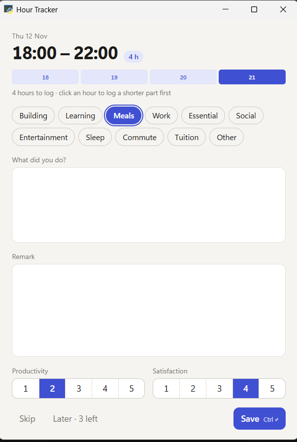
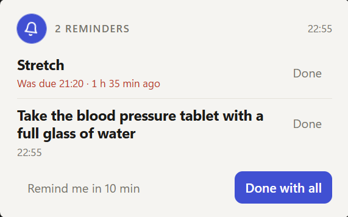
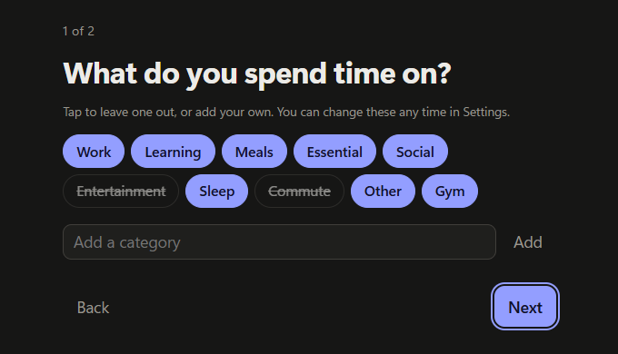
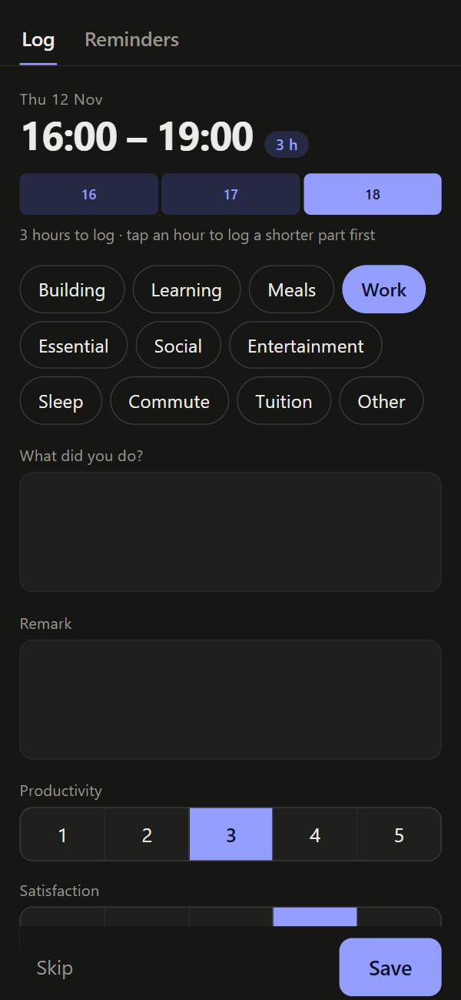

# Hour Tracker

A small Windows app that asks you, once an hour, **what you just did**.
Answer in a few seconds, and over time you see where your days really go.

Free, private, and no account needed.

<p>
  
  &nbsp;
  
</p>

## What it does

- **Asks every hour** in a small window, or every 2 to 12 hours if you prefer. You can pause it, and it stays quiet while you sleep.
- **Takes seconds to answer**: pick a category, write a line, rate how productive and how satisfied you felt. Keyboard shortcuts make it faster still.
- **Handles gaps**: away for a while? Log the missed hours in one go, or split them up ("22:00 to 06:00 sleep, then breakfast").
- **History**: look back at any day, fix a typo, or fill in hours you missed.
- **Reminders** for medicine, water, calls: a card that stays on top with a soft chime until you press Done. One-time reminders can delete themselves once done.
- **Light and dark mode**, and every window resizes nicely.
- **Optional, on your phone too**: connect your own Google Sheet and you get a phone page to log hours and manage reminders, a notification (email or Telegram) when an hour is still unlogged, and reminders that ring on your phone through Google Calendar, even without internet.

## Install

You need Windows 10 or 11.

1. Download **HourTracker-x.y.z.zip** from the [latest release](https://github.com/Samson-debug/hour-tracker/releases/latest).
2. Unzip it and move the **Hour Tracker** folder somewhere you keep, for example Documents.
3. Double-click **Hour Tracker.exe**.
4. Windows may say *"Windows protected your PC"*. The app isn't signed with a paid certificate, that's all.
   Click **More info → Run anyway**. You only do this once.
5. A one-minute welcome screen sets you up.



After that, the app lives in the taskbar corner as a **blue clock icon** (click the **^** arrow if you don't see it).
Right-click it for **History**, **Reminders** and **Settings**. It starts with Windows by itself.

## Answering quickly

| Key | Does |
|---|---|
| a letter | picks the category starting with it (press again for the next one) |
| 1 to 5 | sets productivity, then satisfaction |
| Enter | saves (when you're not typing in a text box) |
| Ctrl + Enter | saves, from anywhere |

Click an hour in the strip at the top to log just part of a longer stretch. The rest comes next.
**Later** asks again in 10 minutes.

## On your phone (optional)



This needs your own Google Sheet; it's where your hours meet your phone. Setting it up takes about five minutes:

1. Right-click the tray icon → **Settings** → **Google Sheet**, and follow the steps there.
2. Then **Settings** → **Phone**: scan the QR code with your phone's camera and add the page to your home screen.
3. Choose how you hear about unlogged hours: **Email** (nothing to set up) or **Telegram** (make a bot in two minutes; the app shows how).

Your reminders are also copied into a Google Calendar called *Hour Tracker reminders*, so your phone rings for them even offline.

<br clear="right">

## Your data

- Everything is kept on your PC, in `%APPDATA%\HourTracker`.
- If you connect a Google Sheet, it's **your** sheet in **your** Google account.
- There is no server, no account and no tracking. Nobody else, including whoever gave you the app, can see your data.

## Is it really free?

Yes, and it stays that way. The app runs on your PC. The optional phone part uses your own Google account's free services (Sheets, Apps Script, Gmail, Calendar) and, if you choose it, Telegram's free bots. There is nothing to pay for and nothing that expires.

## Questions

**Does it slow my PC down?**
No. While it waits it uses about 50 MB of memory and no processor time. The question window opens, saves and closes.

**I missed a few hours. Are they lost?**
No. The next question covers every hour since your last answer (up to a day back), and you can fill in older gaps in **History**.

**How do I uninstall it?**
Right-click the tray icon → **Settings** → untick **Start with Windows**, then **Quit**. Delete the folder.
To delete your data too, delete `%APPDATA%\HourTracker`.

## For developers

The app is Python: [pywebview](https://pywebview.flowrl.com/) windows with HTML and CSS, a [pystray](https://github.com/moses-palmer/pystray) tray icon, and SQLite. The optional sync is a Google Apps Script web app.

Run from source (Python 3.12):

```bash
pip install -r requirements.txt
pythonw "Hour Tracker.pyw"
```

Build the zip for others (it ends up in `dist/`):

```bash
pip install pyinstaller
python build.py
```

| Path | What it is |
|---|---|
| `hourtracker/tray.py` | the tray icon: the only part that keeps running, and it sleeps until something is due |
| `hourtracker/popup.py`, `popup.html` | the hourly question window |
| `hourtracker/manager.py`, `manager.html` | History, Reminders, Settings and the welcome screen |
| `hourtracker/remind.py`, `remind.html` | the reminder card |
| `hourtracker/core.py` | data, schedule and sync |
| `hourtracker/sheet.gs` | the Google Sheet script, with the phone page built in when the app copies it |
| `build.py` | makes the zip |

To give friends a ready-made Google Sheet they can copy, see **Settings → Share with friends** when running from source.

## License

Hour Tracker is free software under the [GNU General Public License v3.0](LICENSE): you may use, share and change it,
and versions you share must stay under the same license.
